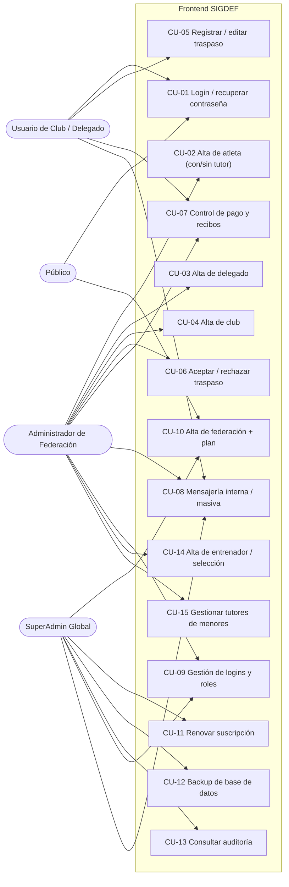

# 02 — Casos de Uso

**Proyecto:** SIGDEF — Frontend de Gestión Deportiva Federativa (`FrontSigdef`)
**Última actualización: 2026-09-27**
**Notación:** UML (diagrama de casos de uso) · especificación textual de escenarios

---

## Índice

1. [Introducción](#1-introducción)
2. [Diagrama de casos de uso](#2-diagrama-de-casos-de-uso)
3. [Actores](#3-actores)
4. [Resumen de casos de uso](#4-resumen-de-casos-de-uso)
5. [Especificación de casos de uso](#5-especificación-de-casos-de-uso)
   - [CU-01 — Iniciar sesión / recuperar contraseña](#cu-01--iniciar-sesión--recuperar-contraseña)
   - [CU-02 — Alta de atleta (con/sin tutor)](#cu-02--alta-de-atleta-consin-tutor)
   - [CU-03 — Alta de delegado](#cu-03--alta-de-delegado)
   - [CU-04 — Alta de club](#cu-04--alta-de-club)
   - [CU-05 — Registrar / editar traspaso](#cu-05--registrar--editar-traspaso)
   - [CU-06 — Aceptar / rechazar traspaso](#cu-06--aceptar--rechazar-traspaso)
   - [CU-07 — Control de pago y recibos](#cu-07--control-de-pago-y-recibos)
   - [CU-08 — Mensajería interna / masiva](#cu-08--mensajería-interna--masiva)
   - [CU-09 — Gestión de logins y roles](#cu-09--gestión-de-logins-y-roles)
   - [CU-10 — Alta de federación + plan](#cu-10--alta-de-federación--plan)
   - [CU-11 — Renovar suscripción](#cu-11--renovar-suscripción)
   - [CU-12 — Backup de base de datos](#cu-12--backup-de-base-de-datos)
   - [CU-13 — Consultar auditoría](#cu-13--consultar-auditoría)
   - [CU-14 — Alta de entrenador / selección](#cu-14--alta-de-entrenador--selección)
   - [CU-15 — Gestionar tutores de menores](#cu-15--gestionar-tutores-de-menores)
6. [Pie del pack](#pie-del-pack)

---

## 1. Introducción

Este documento especifica los **casos de uso** del frontend SIGDEF. Cada caso de uso describe los actores intervinientes, precondiciones, flujo principal, flujos alternativos, postcondiciones y los requerimientos funcionales asociados (ver [01 — Requerimientos](./01-Requerimientos-Usuario.md)).

El sistema es una SPA React 19 con tres universos de navegación según el rol: **Federación** (`/dashboard`), **Club** (`/club`) y **SuperAdmin** (`/superadmin`).

---

## 2. Diagrama de casos de uso

---

## 3. Actores

| Actor | Tipo | Descripción |
|-------|------|-------------|
| **Público** | Primario (no autenticado) | Accede a la landing y al login. |
| **Usuario de Club** | Primario | Rol `CLUB`. Opera `/club`: plantel, tutores, entrenadores, delegados, traspasos, mensajes e inscripciones. |
| **Administrador de Federación** | Primario | Rol `FEDERACION`. Opera `/dashboard`: padrón completo, pagos, traspasos, logins y auditoría local. |
| **SuperAdmin Global** | Primario | Rol `SUPERADMIN`. Opera `/superadmin`: federaciones, planes, suscripciones, backups, auditoría global y modo supervisión. |
| **Backend SportTrack / SIGDEF** | Secundario (sistema) | API REST `.NET 10` + PostgreSQL que resuelve reglas de negocio, validaciones y persistencia. |

---

## 4. Resumen de casos de uso

| CU | Nombre | Actor principal | RF asociados |
|----|--------|-----------------|--------------|
| CU-01 | Iniciar sesión / recuperar contraseña | Público / cualquier rol | RF-01…RF-06 |
| CU-02 | Alta de atleta (con/sin tutor) | Federación | RF-07…RF-16 |
| CU-03 | Alta de delegado | Federación | RF-20…RF-23 |
| CU-04 | Alta de club | Federación | RF-17…RF-19 |
| CU-05 | Registrar / editar traspaso | Club (destino) | RF-31, RF-32, RF-36, RF-38 |
| CU-06 | Aceptar / rechazar traspaso | Federación + Club origen | RF-33…RF-35, RF-37 |
| CU-07 | Control de pago y recibos | Federación / Club | RF-39…RF-44, RF-52, RF-53 |
| CU-08 | Mensajería interna / masiva | Todos | RF-45…RF-51 |
| CU-09 | Gestión de logins y roles | Federación / SuperAdmin | RF-54…RF-59 |
| CU-10 | Alta de federación + plan | SuperAdmin | RF-61, RF-62, RF-63 |
| CU-11 | Renovar suscripción | SuperAdmin | RF-63, RF-64, RF-66 |
| CU-12 | Backup de base de datos | SuperAdmin | RF-72…RF-74 |
| CU-13 | Consultar auditoría | SuperAdmin / Federación | RF-69…RF-71 |
| CU-14 | Alta de entrenador / selección | Federación | RF-28…RF-30 |
| CU-15 | Gestionar tutores de menores | Federación / Club | RF-24…RF-27 |

---

## 5. Especificación de casos de uso

### CU-01 — Iniciar sesión / recuperar contraseña

| Campo | Valor |
|-------|-------|
| **Actor principal** | Público / cualquier rol |
| **Actores secundarios** | Backend (API), administrador de federación (recuperación) |
| **Precondiciones** | El backend está disponible. El usuario posee credenciales válidas o desea solicitar el reseteo. |
| **Postcondiciones** | Sesión iniciada con rol resuelto y guardada en `localStorage`, o solicitud de reseteo enviada. |

**Flujo principal**

1. El usuario abre `/login` e ingresa usuario y contraseña.
2. El sistema envía `POST /Auth/login` (timeout 90 s).
3. El backend responde con `token` y datos (rol, `idFederacion`, `idClub`, plan, nombre).
4. El sistema decodifica el JWT, resuelve el rol (`SUPERADMIN` / `CLUB` / `FEDERACION`) y guarda la sesión. El plan se normaliza con `planHelpers`.
5. El sistema guarda el usuario en `localStorage` y redirige a `/superadmin`, `/dashboard` o `/club`.
6. `PrivateRoute` arranca `warmupApi()` para despertar el API. Para roles distintos de `SUPERADMIN`, `PlanGuard` exige el flag `accesoSigdef` antes de renderizar las rutas.

**Flujos alternativos**

- **A1. Credenciales inválidas:** el API responde `401`; el sistema muestra "Usuario o contraseña incorrectos".
- **A2. Plan sin `accesoSigdef`:** `PlanGuard` bloquea el acceso a las rutas internas (no aplica al `SUPERADMIN`) e indica que se necesita un plan SIGDEF o Pack Dúo.
- **A3. Recuperar contraseña:** el usuario abre el modal "Recuperar contraseña", ingresa usuario y nota opcional; el sistema envía `POST /Auth/solicitar-reset-password` y notifica al administrador de su federación.
- **A4. Sesión expirada:** cualquier respuesta `401` con sesión activa limpia el `localStorage` y redirige a `/login`.
- **A5. API dormida:** se reintenta hasta 2 veces; si falla, se informa el posible cold start de Render.

**Reglas:** RN-06, RN-07. **Código:** `src/pages/Login.jsx`, `src/context/AuthContext.jsx`, `src/services/api.js`.

---

### CU-02 — Alta de atleta (con/sin tutor)

| Campo | Valor |
|-------|-------|
| **Actor principal** | Administrador de Federación |
| **Actores secundarios** | Club (consulta su plantel), Backend |
| **Precondiciones** | Sesión `FEDERACION` activa con plan que incluye SIGDEF. |
| **Postcondiciones** | Atleta creado en el padrón; si es menor, con tutor vinculado. |

**Flujo principal (con tutor)**

1. El usuario ingresa a `/dashboard/atletas` y presiona **Nuevo**.
2. Completa nombre, apellido, documento, fecha de nacimiento y sexo.
3. El sistema detecta que es **menor de edad** y habilita la sección de tutor.
4. El usuario completa documento, nombre, apellido y parentesco del tutor.
5. Opcionalmente asigna club, estado de pago, categoría, becas y apto médico.
6. Al guardar, el sistema crea persona + participante (`POST /Atleta/full`) y la relación `AtletaTutor`.
7. El atleta aparece en el listado paginado con el indicador de tutor.

**Flujo alternativo (sin tutor)**

- **A1. Atleta mayor:** la sección de tutor se oculta; el alta no exige tutor.
- **A2. Documento duplicado:** el backend responde con error de unicidad; la UI muestra "Ese DNI o usuario ya está registrado".

**Reglas:** RN-03, RN-14, RN-17. **Código:** `src/pages/FederacionAdmin/Atletas/AtletasForm.jsx`, `AtletasList.jsx`, `ClubAdmin/Atletas/ClubAtletas.jsx`.

---

### CU-03 — Alta de delegado

| Campo | Valor |
|-------|-------|
| **Actor principal** | Administrador de Federación |
| **Actores secundarios** | Backend |
| **Precondiciones** | Sesión `FEDERACION`; el plan incluye `accesoDashboardClub` (para crear el login Club). |
| **Postcondiciones** | Delegado dado de alta: persona + login rol `Club` + ficha `DelegadoClub`. |

**Flujo principal**

1. El usuario ingresa a `/dashboard/delegados` y presiona **Nuevo**.
2. Ingresa el DNI; el sistema busca la persona (`GET /Persona/documento/{dni}`) y autocompleta si existe.
3. Completa/normaliza datos personales y **selecciona un club** (obligatorio).
4. Al guardar: (a) crea/actualiza la persona, (b) crea el login `Club` (`POST /Auth/register`) con usuario/contraseña = DNI, (c) crea la ficha `DelegadoClub`.
5. El sistema confirma y navega al listado.

**Flujos alternativos**

- **A1. Persona inexistente:** se crea nueva (`POST /Persona`).
- **A2. Sin club:** el sistema bloquea el guardado ("Para crear el login de delegado tenés que seleccionar un club").
- **A3. Plan insuficiente:** el sistema bloquea el alta e indica actualizar a Profesional o superior.
- **A4. Persona ya entrenadora:** se reutiliza la ficha existente (un entrenador puede ser delegado).

**Reglas:** RN-04, RN-05, RN-14. **Código:** `src/pages/FederacionAdmin/Delegados/DelegadosForm.jsx`.

---

### CU-04 — Alta de club

| Campo | Valor |
|-------|-------|
| **Actor principal** | Administrador de Federación |
| **Actores secundarios** | Backend |
| **Precondiciones** | Sesión `FEDERACION` activa. |
| **Postcondiciones** | Club creado y asociado a la federación. |

**Flujo principal**

1. El usuario ingresa a `/dashboard/clubes` y presiona **Nuevo**.
2. Completa los datos del club (nombre, sigla, datos de contacto) y guarda (`POST /Clubes`).
3. El sistema normaliza `sigla → siglas` e `id → idClub`.
4. El club aparece en el listado y puede consultarse en detalle (`/clubes/detalles/:id`), mostrando su plantel y delegados.

**Alternativas**

- **A1. Edición:** se reutiliza el formulario (`PUT /Clubes/{id}`).
- **A2. Baja:** se elimina con `DELETE /Clubes/{id}` (no debe tener atletas vinculados).

**Código:** `src/pages/FederacionAdmin/Clubes/*`.

---

### CU-05 — Registrar / editar traspaso

| Campo | Valor |
|-------|-------|
| **Actor principal** | Usuario de Club (destino) |
| **Actores secundarios** | Backend, federación (verificación) |
| **Precondiciones** | Existe un **periodo de traspaso activo**. El atleta pertenece a otro club o es Agente Libre. |
| **Postcondiciones** | Solicitud creada en estado `PendienteFederacion`. |

**Flujo principal**

1. El usuario entra a `/club/traspasos/solicitar`.
2. El sistema consulta el periodo activo (`GET /Traspaso/periodo-activo`).
3. Si hay periodo vigente, busca atletas por nombre o documento (`GET /Traspaso/buscar-atletas`).
4. El usuario selecciona el atleta, agrega un motivo y confirma.
5. El sistema crea la solicitud (`POST /Traspaso`) con el club destino = club del usuario.
6. Se notifica el cambio (`notifyTraspasosChanged`, `notifyMensajesChanged`) y se informa que la federación verificará la deuda.

**Flujos alternativos**

- **A1. Periodo cerrado:** se muestra un aviso y no se permite solicitar.
- **A2. Atleta en el propio club:** no aparece en la búsqueda.
- **A3. Agente Libre:** el flujo es idéntico; la federación verificará deudas al aprobar.
- **A4. Cancelar:** desde "Mis solicitudes enviadas" se cancela una solicitud en estado `PendienteOrigen` o `PendienteFederacion`.

**Reglas:** RN-01, RN-18, RN-19. **Código:** `src/pages/ClubAdmin/Traspasos/TraspasosSolicitar.jsx`, `TraspasosEntrantes.jsx`.

---

### CU-06 — Aceptar / rechazar traspaso

| Campo | Valor |
|-------|-------|
| **Actor principal** | Administrador de Federación (habilitar) · Usuario de Club origen (aceptar/rechazar) |
| **Actores secundarios** | SuperAdmin (forzar), Backend |
| **Precondiciones** | Existe una solicitud `PendienteFederacion` (federación) o `PendienteOrigen` (club origen). |
| **Postcondiciones** | Traspaso ejecutado (`Aprobado`) o rechazado; el atleta cambia de club o permanece. |

**Flujo principal**

1. La federación abre la bandeja de traspasos (`/dashboard/traspasos`) y entra al detalle de la solicitud.
2. El sistema carga la solicitud y sus validaciones (`GET /Traspaso/{id}`, `/{id}/validaciones`).
3. Si `puedeAprobar` es verdadero, la federación presiona **Habilitar traspaso** (`/aprobar`); la solicitud pasa a `PendienteOrigen`.
4. El **club origen** entra a `/club/traspasos/salientes` y presiona **Aceptar** (`/aceptar-origen`); la solicitud pasa a `Aprobado` y el atleta se transfiere.
5. Alternativamente, el club origen **Rechaza** (`/rechazar-origen`) con un motivo; pasa a `RechazadoOrigen`.

**Flujos alternativos**

- **A1. Validaciones bloqueantes:** el botón "Habilitar" queda deshabilitado y se listan los items que fallan (p. ej. deuda).
- **A2. Forzar (SuperAdmin):** en modo supervisión aparece "Forzar habilitación" (`/aprobar?forzar=true`).
- **A3. Rechazo de la federación:** `Rechazar` + motivo → estado `RechazadoFederacion`.
- **A4. Exportación:** la federación exporta el listado a CSV por periodo/estado.

**Reglas:** RN-02, RN-12. **Código:** `FederacionAdmin/Traspasos/*`, `ClubAdmin/Traspasos/*`.

---

### CU-07 — Control de pago y recibos

| Campo | Valor |
|-------|-------|
| **Actor principal** | Administrador de Federación · Usuario de Club |
| **Actores secundarios** | Backend |
| **Precondiciones** | Sesión activa. |
| **Postcondiciones** | Estado de pago actualizado y/o recibo registrado/eliminado. |

**Flujo principal (federación)**

1. El usuario entra a `/dashboard/pagos`, pestaña **Clubes**.
2. Alterna el interruptor de afiliación de un club (`PUT /pagos/clubes/{id}/toggle`).
3. Cambia a la pestaña **Atletas** y alterna el estado de pago (`PUT /pagos/atletas/{id}/toggle`).
4. Presiona **Registrar Recibo** y completa monto, referencia y notas (`POST /pagos/registrar`).
5. Consulta la pestaña **Recibos** con totales por club/atleta y elimina recibos (`DELETE /pagos/{id}` o `/pagos/bulk`).

**Flujo principal (club)**

1. El club entra a `/club/atletas` y marca a un atleta pagado/pendiente (`PUT /Atleta/{id}`).
2. Puede marcar a todo el plantel como pagado (actualización masiva).

**Flujos alternativos**

- **A1. Fallo de red:** la UI revierte el cambio optimista e informa el error.
- **A2. Registro de inscripción:** el club consulta "Mis Inscripciones"; la federación exporta CSV y elimina registros.

**Reglas:** RN-13. **Código:** `FederacionAdmin/Pagos/PagosClubes.jsx`, `ClubAdmin/Atletas/ClubAtletas.jsx`, `Shared/RegistroInscripciones.jsx`.

---

### CU-08 — Mensajería interna / masiva

| Campo | Valor |
|-------|-------|
| **Actor principal** | SuperAdmin · Federación · Club |
| **Actores secundarios** | Backend |
| **Precondiciones** | Sesión activa con rol habilitado para mensajería. |
| **Postcondiciones** | Hilo creado/respondido; comunicado masivo distribuido; contadores actualizados. |

**Flujo principal (individual)**

1. El usuario entra a `/dashboard/mensajes` (o `/club/mensajes`, `/superadmin/mensajes`).
2. Redacta un mensaje, elige destinatario, asunto y cuerpo (`POST /mensajes/hilos`).
3. El sistema abre el hilo; al leerlo lo marca como leído (`PATCH /mensajes/hilos/{id}/leer`).
4. El usuario responde (`POST /mensajes/hilos/{id}/responder`).

**Flujo principal (masivo, SuperAdmin/Federación)**

1. El usuario elige **Comunicado masivo**.
2. Selecciona destinatarios agrupados (SuperAdmin → administradores por federación; Federación → clubes de su federación).
3. Envía (`POST /mensajes/hilos/masivo`); se crea un hilo privado por destinatario.
4. El comunicado aparece en **Comunicados enviados** con cantidad de destinatarios, leídos y respondidos.

**Flujos alternativos**

- **A1. Sin rol de mensajería:** el contador no se consulta y la vista no está disponible.
- **A2. Aislamiento:** los hilos corresponden solo al universo SIGDEF (`X-Client-App: sigdef`).

**Reglas:** RN-15. **Código:** `src/pages/Shared/MensajesPage.jsx`, `services/messageService.js`, `hooks/useUnreadMessages.js`.

---

### CU-09 — Gestión de logins y roles

| Campo | Valor |
|-------|-------|
| **Actor principal** | Administrador de Federación · SuperAdmin |
| **Actores secundarios** | Backend |
| **Precondiciones** | Sesión activa. |
| **Postcondiciones** | Credencial creada/actualizada, contraseña cambiada o cuenta habilitada/deshabilitada. |

**Flujo principal**

1. El usuario entra a `/dashboard/usuarios` (o `/superadmin/logins`, `/superadmin/federacion/:fedId/usuarios`).
2. Presiona **Nueva credencial**; elige rol (`Admin`, `Club` o un rol de juez).
3. El sistema valida el plan: `Club` requiere `accesoDashboardClub`; los jueces requieren `accesoControlesLive`.
4. Completa username, email y contraseña; guarda (`POST /Auth/register`).
5. Puede cambiar contraseña (`PUT /Auth/usuarios/{id}/password`), editar perfil (`PUT /Auth/usuarios/{id}/perfil`) o **habilitar/deshabilitar** (`PATCH /Auth/usuarios/{id}/toggle-activo`).

**Flujos alternativos**

- **A1. Plan insuficiente:** el rol `Club` o los jueces quedan bloqueados con aviso.
- **A2. Delegado/Federación:** un login `Club` debe vincularse a un club.
- **A3. SuperAdmin:** puede filtrar logins por federación.

**Reglas:** RN-06. **Código:** `FederacionAdmin/Usuarios/GestionLoginsSection.jsx`, `services/AuthService.js`.

---

### CU-10 — Alta de federación + plan

| Campo | Valor |
|-------|-------|
| **Actor principal** | SuperAdmin Global |
| **Actores secundarios** | Backend, administrador de la nueva federación |
| **Precondiciones** | Sesión `SUPERADMIN` activa. |
| **Postcondiciones** | Federación creada con su administrador principal y plan asignado. |

**Flujo principal**

1. El usuario entra a `/superadmin/federaciones/nueva`.
2. Completa nombre, sigla, email institucional y datos de contacto.
3. Carga usuario, email y contraseña del administrador (mín. 6 caracteres, confirmación coincidente).
4. Al guardar, el sistema llama `POST /saas/create-federacion`.
5. La federación aparece en la gestión con su plan; puede asignarse/cambiarse el plan (`POST /SaaS/asignar-plan`).

**Flujos alternativos**

- **A1. Validación fallida:** nombre/email/usuario/contraseña inválidos bloquean el guardado.
- **A2. Edición:** `PUT /Federaciones/{id}`.
- **A3. Baja:** `DELETE /Federaciones/{id}` (requiere que no tenga clubes/atletas).

**Código:** `SuperAdmin/FederacionesForm.jsx`, `FederacionesManagement.jsx`, `services/saasService.js`.

---

### CU-11 — Renovar suscripción

| Campo | Valor |
|-------|-------|
| **Actor principal** | SuperAdmin Global |
| **Actores secundarios** | Backend |
| **Precondiciones** | La federación está vencida o bloqueada por pago. |
| **Postcondiciones** | Nuevo vencimiento calculado y estado de acceso restablecido. |

**Flujo principal**

1. El usuario abre el panel de configuración SaaS de una federación.
2. El sistema muestra el **estado de acceso** (permitido / suspendido / bloqueado por pago / vencido).
3. Según la frecuencia (`Mensual`/`Anual`), calcula el nuevo vencimiento a partir del vencimiento vigente o de hoy.
4. El usuario confirma **RENOVAR SUSCRIPCIÓN**.
5. El sistema actualiza la federación (`PUT /Federaciones/{id}`) con `fechaVencimientoPlan` y `bloqueadaPorFaltaDePago=false`.

**Flujos alternativos**

- **A1. Cambio de frecuencia:** editar la frecuencia recalcula el vencimiento en el guardado.
- **A2. Cambio de plan:** `POST /SaaS/asignar-plan`.

**Reglas:** RN-11, RN-20. **Código:** `SuperAdmin/FederacionesManagement.jsx`.

---

### CU-12 — Backup de base de datos

| Campo | Valor |
|-------|-------|
| **Actor principal** | SuperAdmin Global |
| **Actores secundarios** | Backend |
| **Precondiciones** | Sesión `SUPERADMIN` activa. |
| **Postcondiciones** | Archivo `.sql` descargado y registrado en el historial. |

**Flujo principal**

1. El usuario entra a `/superadmin/backups`.
2. Selecciona el alcance: **Base completa** o **Por federación**.
3. Si es por federación, elige la federación.
4. Presiona **Descargar .sql**; el sistema descarga el archivo (`GET /backup/download`).
5. El historial (`GET /backup/history`) muestra la operación.

**Flujos alternativos**

- **A1. Sin federación seleccionada:** el sistema indica "Seleccioná una federación".
- **A2. Timeout:** el cliente usa un timeout extendido (300 s) para el dump.

**Código:** `SuperAdmin/BackupsManagement.jsx`, `services/backupService.js`.

---

### CU-13 — Consultar auditoría

| Campo | Valor |
|-------|-------|
| **Actor principal** | SuperAdmin Global · Administrador de Federación |
| **Actores secundarios** | Backend |
| **Precondiciones** | Sesión activa. |
| **Postcondiciones** | Bitácora consultada. |

**Flujo principal**

1. **SuperAdmin:** entra a `/superadmin/auditoria`, que consulta `GET /support/logs?limit=100`.
2. **Federación:** el Dashboard muestra la actividad reciente (`GET /Auditoria?limit=200`).
3. El sistema clasifica cada evento (Acceso, Seguridad, Configuración) y permite buscar.

**Flujos alternativos**

- **A1. Ruido de autenticación:** se filtran eventos `ERROR_FATAL` con "No authentication handler is registered for the scheme".

**Código:** `SuperAdmin/Auditoria.jsx`, `pages/Dashboard.jsx`.

---

### CU-14 — Alta de entrenador / selección

| Campo | Valor |
|-------|-------|
| **Actor principal** | Administrador de Federación |
| **Actores secundarios** | Backend |
| **Precondiciones** | Sesión `FEDERACION` activa. |
| **Postcondiciones** | Entrenador registrado, eventualmente asociado a una selección por categoría. |

**Flujo principal**

1. El usuario entra a `/dashboard/entrenadores` y presiona **Nuevo**.
2. Completa datos personales, licencia y (opcionalmente) club.
3. Opcionalmente marca **Pertenece a Selección** y elige la categoría (1–9).
4. Guarda (`POST /Entrenador`).
5. La vista `/dashboard/selecciones` agrupa a los entrenadores por categoría.

**Flujos alternativos**

- **A1. Entrenador de club:** sin selección.
- **A2. Rutas legacy:** `entrenadores-seleccion*` redirigen a las rutas unificadas.

**Reglas:** RN-17. **Código:** `FederacionAdmin/Entrenadores/*`, `EntrenadorSeleccion/*`.

---

### CU-15 — Gestionar tutores de menores

| Campo | Valor |
|-------|-------|
| **Actor principal** | Administrador de Federación · Usuario de Club |
| **Actores secundarios** | Backend |
| **Precondiciones** | Sesión activa; existe al menos un atleta menor. |
| **Postcondiciones** | Tutor registrado y vinculado (o desvinculado) del atleta. |

**Flujo principal**

1. El usuario entra a `/dashboard/tutores` (o `/club/tutores`) y crea un tutor (`POST /Tutor`).
2. Vincula el tutor con el atleta menor (`POST /AtletaTutor` con `ParticipanteId`, `IdTutor`, `Parentesco`).
3. En el padrón, la celda de tutor indica el estado del atleta.
4. El usuario puede desvincular (`DELETE /AtletaTutor/{idRelacion}`).

**Flujos alternativos**

- **A1. Asignar tutor existente:** se selecciona un tutor del club y se vincula.
- **A2. Alta desde el club:** `/club/tutores/nuevo?atletaId=…` precarga el atleta.

**Reglas:** RN-03. **Código:** `FederacionAdmin/Tutores/*`, `ClubAdmin/Tutores/*`, `components/common/TutorStatusCell.jsx`.

---

## Pie del pack

| Documento anterior | Documento actual | Documento siguiente |
|--------------------|------------------|---------------------|
| [01 — Requerimientos](./01-Requerimientos-Usuario.md) | **02 — Casos de Uso** | [03 — Diagramas de Flujo →](./03-Diagramas-de-Flujo.md) |

[Índice del pack](./README.md#índice-del-pack) · [README](./README.md) · [01](./01-Requerimientos-Usuario.md) · [03](./03-Diagramas-de-Flujo.md) · [04](./04-Manual-de-Usuario.md) · [05](./05-Manual-Tecnico.md) · [06](./06-Manual-Instalacion-Despliegue.md)
