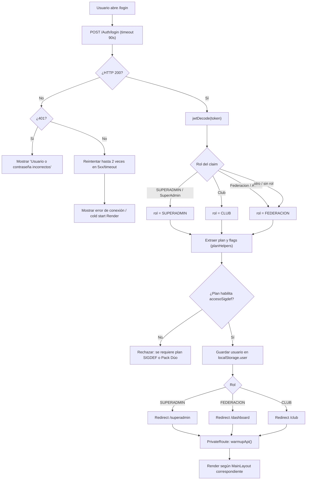
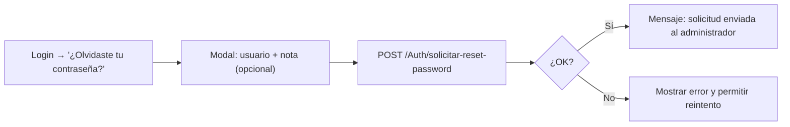
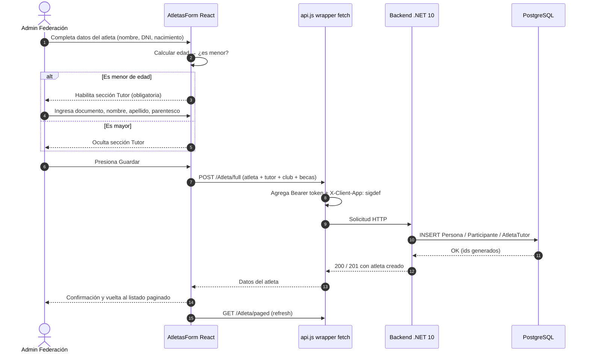
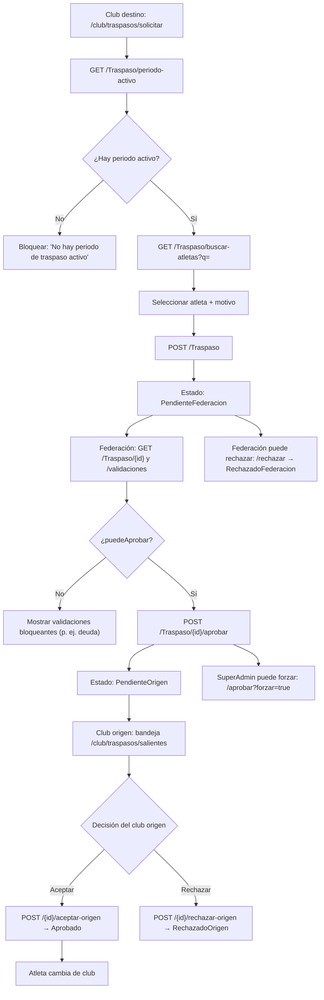
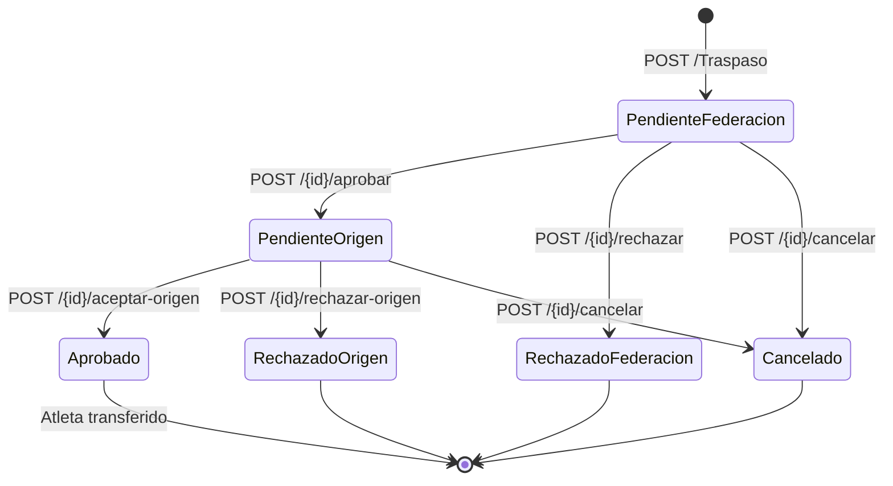
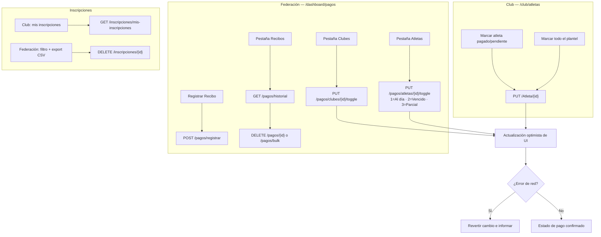
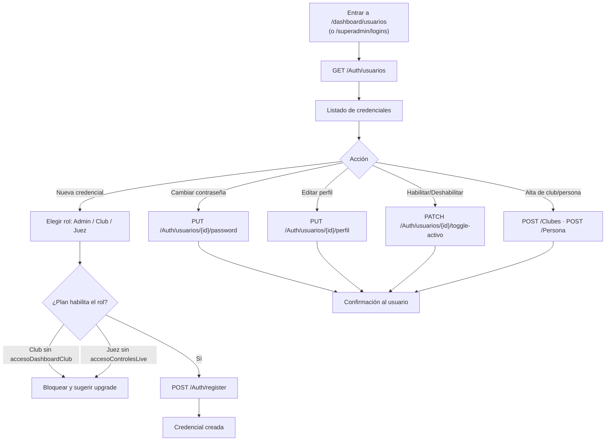
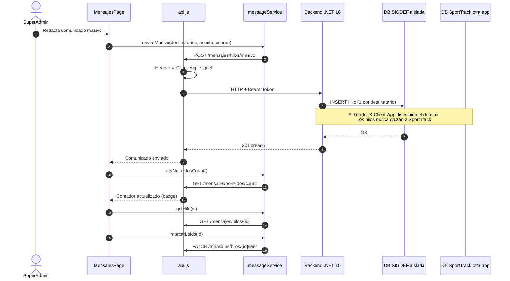
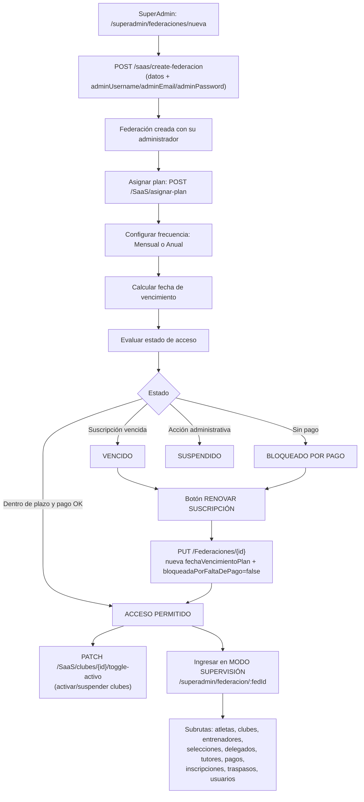
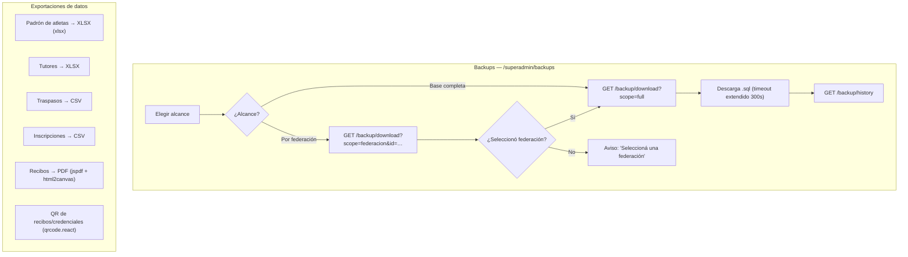

# 03 — Diagramas de Flujo

**Proyecto:** SIGDEF — Frontend de Gestión Deportiva Federativa (`FrontSigdef`)
**Última actualización: 2026-09-27**
**Notación:** Mermaid (`flowchart`, `sequenceDiagram`, `stateDiagram-v2`)

---

## Índice

1. [Introducción](#1-introducción)
2. [(a) Login y resolución de rol/plan](#a-login-y-resolución-de-rolplan)
3. [(b) Alta de atleta con tutor](#b-alta-de-atleta-con-tutor)
4. [(c) Traspaso de atleta](#c-traspaso-de-atleta)
5. [(d) Control de pagos y recibos](#d-control-de-pagos-y-recibos)
6. [(e) Gestión de logins y accesos](#e-gestión-de-logins-y-accesos)
7. [(f) Mensajería con aislamiento X-Client-App](#f-mensajería-con-aislamiento-x-client-app)
8. [(g) Ciclo SaaS de una federación](#g-ciclo-saas-de-una-federación)
9. [(h) Backups y exportaciones](#h-backups-y-exportaciones)
10. [Pie del pack](#pie-del-pack)

---

## 1. Introducción

Los diagramas describen los flujos de la SPA y su interacción con la API `.NET 10`. Toda petición viaja por el wrapper `src/services/api.js`, que agrega `Authorization: Bearer <token>`, `X-Client-App: sigdef`, `credentials: include`, timeout de 45 s (90 s login) y hasta 2 reintentos ante `5xx`/timeout.

---

## (a) Login y resolución de rol/plan

**Flujo auxiliar — recuperar contraseña**

**Nota:** el login requiere que el plan incluya `accesoSigdef` (salvo SuperAdmin, ver RN-07). Cualquier `401` con sesión activa limpia `localStorage` y redirige a `/login` (RF-05).

---

## (b) Alta de atleta con tutor

**Errores típicos:** `409` (documento/usuario duplicado) → "Ese DNI ya está registrado"; `400` (validación) → se muestran los campos.

---

## (c) Traspaso de atleta

### (c.1) Flujo general

### (c.2) Máquina de estados

| Estado | Significado | Quién actúa |
|--------|-------------|-------------|
| `PendienteFederacion` | Esperando verificación de la federación | Federación |
| `PendienteOrigen` | Habilitado; espera decisión del club origen | Club origen |
| `Aprobado` | Traspaso ejecutado | — |
| `RechazadoFederacion` | La federación rechazó | — |
| `RechazadoOrigen` | El club origen rechazó | — |

---

## (d) Control de pagos y recibos

**Estados de atleta:** `1` Al día · `2` Vencido · `3` Parcial. La cuota de club se controla por interruptor de afiliación.

---

## (e) Gestión de logins y accesos

**Roles de juez** (operan en SportTrack-Front): `Largador`, `Cronometrista`, `JuezControl`, `ControlTecnico`. **Regla:** un delegado es un usuario de rol `Club` vinculado a un club.

---

## (f) Mensajería con aislamiento X-Client-App

**Aislamiento:** todos los endpoints de mensajería exigen el header `X-Client-App: sigdef`; un usuario de SIGDEF no ve hilos de SportTrack y viceversa. Modos de la vista: `super`, `admin`, `club`.

---

## (g) Ciclo SaaS de una federación

**Plan e IDs:** SIGDEF 1–3 · SportTrack 4–6 · Pack Dúo 7–9. Flags: `accesoSigdef`, `accesoSportTrack`, `accesoControlesLive`, `accesoDashboardClub`, `permitirCargaImagenes`, `resultadosTiempoReal`, `exportacionPdf`, `maxAtletas`.

---

## (h) Backups y exportaciones

**Herramientas de exportación:** `xlsx ^0.18.5` (Excel), `jspdf ^3.0.4` + `html2canvas ^1.4.1` (PDF), `qrcode.react ^4.2.0` (QR).

---

## Pie del pack

| Documento anterior | Documento actual | Documento siguiente |
|--------------------|------------------|---------------------|
| [02 — Casos de Uso](./02-Casos-de-Uso.md) | **03 — Diagramas de Flujo** | [04 — Manual de Usuario →](./04-Manual-de-Usuario.md) |

[Índice del pack](./README.md#índice-del-pack) · [README](./README.md) · [01](./01-Requerimientos-Usuario.md) · [02](./02-Casos-de-Uso.md) · [04](./04-Manual-de-Usuario.md) · [05](./05-Manual-Tecnico.md) · [06](./06-Manual-Instalacion-Despliegue.md)
