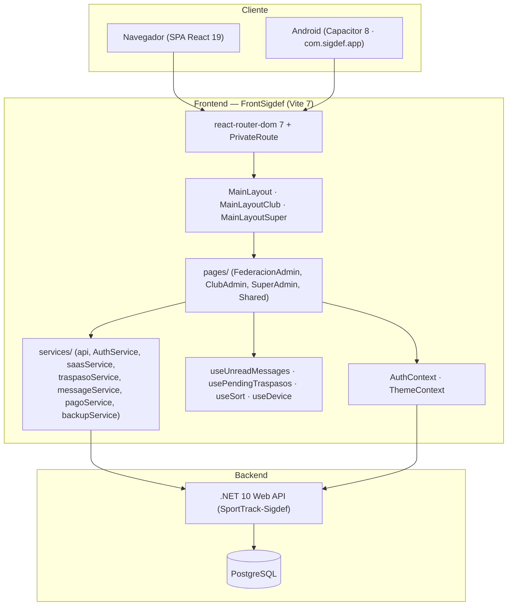
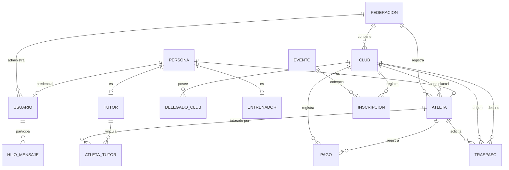

# 05 — Manual Técnico

**Proyecto:** SIGDEF — Frontend de Gestión Deportiva Federativa (`FrontSigdef`)
**Última actualización: 2026-09-27**
**Dirigido a:** Desarrolladores, DevOps y responsables técnicos

---

## Índice

1. [Arquitectura general](#1-arquitectura-general)
2. [Stack y versiones](#2-stack-y-versiones)
3. [Estructura del código](#3-estructura-del-código)
4. [Rutas y guards](#4-rutas-y-guards)
5. [Roles y planes](#5-roles-y-planes)
6. [Servicios y contratos de API](#6-servicios-y-contratos-de-api)
7. [Convenciones de código](#7-convenciones-de-código)
8. [Integración con el backend .NET 10](#8-integración-con-el-backend-net-10)
9. [Modelo de datos relevante](#9-modelo-de-datos-relevante)
10. [Seguridad](#10-seguridad)
11. [Build y variables de entorno](#11-build-y-variables-de-entorno)
12. [Despliegue](#12-despliegue)
13. [Mantenimiento y troubleshooting](#13-mantenimiento-y-troubleshooting)
14. [Deuda técnica y discrepancias](#14-deuda-técnica-y-discrepancias)
15. [Pie del pack](#pie-del-pack)

---

## 1. Arquitectura general



**Patrón:** SPA de tres universos (`/dashboard`, `/club`, `/superadmin`), con autenticación JWT, guardas de rol y de plan, y acceso a datos exclusivamente a través de la capa `services/`.

---

## 2. Stack y versiones

| Componente | Versión | Rol |
|------------|---------|-----|
| React | ^19.2.0 | Librería de UI. |
| React DOM | ^19.2.0 | Renderizado. |
| react-router-dom | ^7.9.6 | Enrutamiento SPA. |
| Vite | ^7.2.4 | Build tool y dev server. |
| ESLint | 9.39.1 | Linting. |
| jwt-decode | ^4.0.0 | Decodificación del JWT. |
| lucide-react | ^0.554.0 | Iconografía. |
| xlsx | ^0.18.5 | Exportación a Excel. |
| jspdf | ^3.0.4 | Generación de PDF. |
| html2canvas | ^1.4.1 | Captura DOM para PDF. |
| qrcode.react | ^4.2.0 | Códigos QR. |
| @capacitor/core, cli, android | ^8.2.0 | Empaquetado Android. |
| Backend | `.NET 10` (`net10.0`) | API REST + reglas de negocio. |
| Base de datos | PostgreSQL | Persistencia. |

**Scripts de `package.json`**

| Script | Comando | Descripción |
|--------|---------|-------------|
| `dev` | `vite --host` | Servidor de desarrollo. |
| `build` | `vite build` | Build de producción. |
| `lint` | `eslint .` | Análisis estático. |
| `preview` | `vite preview` | Previsualización del build. |
| `mobile:sync` | `cap sync` | Sincroniza el build con Android. |
| `mobile:open` | `cap open android` | Abre el proyecto Android. |

**`vite.config.js`:** puerto **5173**, `host: true`, `strictPort: true`.

---

## 3. Estructura del código

```text
src/
├── App.jsx                     # Definición de rutas y guards
├── main.jsx                    # Bootstrap React
├── context/
│   ├── AuthContext.jsx         # Sesión, JWT, roles, planes
│   └── ThemeContext.jsx        # Tema claro/oscuro
├── hooks/
│   ├── useUnreadMessages.js    # Badge de mensajes no leídos
│   ├── usePendingTraspasos.js  # Contador de traspasos pendientes
│   ├── useSort.js              # Ordenamiento de tablas
│   └── useDevice.js            # Detección de dispositivo
├── services/
│   ├── api.js                  # Wrapper fetch (núcleo HTTP)
│   ├── AuthService.js          # Logins y credenciales
│   ├── saasService.js          # Planes, federaciones, métricas, auditoría
│   ├── traspasoService.js      # Traspasos y periodos
│   ├── messageService.js       # Mensajería
│   ├── pagoService.js          # Pagos y recibos
│   └── backupService.js        # Backups
├── utils/
│   ├── apiHelpers.js           # Mappers de respuesta del API
│   ├── planHelpers.js          # Normalización de planes y flags
│   ├── plansCatalogDisplay.js  # Presentación del catálogo de planes
│   ├── enums.js                # Enumeraciones (estados, roles)
│   ├── atletaUtils.js  traspasoUtils.js  searchUtils.js
│   ├── delegadoHelpers.js  friendlyError.js  categoryConfig.js
├── components/
│   ├── common/                 # Button, Card, Modal, DataTable, Pagination,
│   │                           # PageHeader, SearchInput, MobileCard,
│   │                           # ConfirmationModal, PlanGuard, GlobalSearch,
│   │                           # ThemeToggle, DocumentUploadModal,
│   │                           # DocumentViewerModal, TableActions, TutorStatusCell
│   ├── forms/                  # Campos reutilizables
│   ├── layout/                 # MainLayout, MainLayoutClub, MainLayoutSuper,
│   │                           # Navbar(s), Sidebar(s), MobileNavBar
│   └── modals/                 # Modales de negocio
├── pages/
│   ├── Login.jsx
│   ├── Dashboard.jsx
│   ├── HomePage.jsx            # Landing + plansData.js
│   ├── FederacionAdmin/        # Atletas, Clubes, Delegados, Tutores,
│   │                           # Entrenadores, EntrenadorSeleccion, Selecciones,
│   │                           # Pagos, Traspasos, Usuarios, Federacion
│   ├── ClubAdmin/              # ClubInfo, Atletas, Tutores, Entrenadores,
│   │                           # Delegados, Traspasos
│   ├── SuperAdmin/             # SuperDashboard, FederacionesManagement,
│   │                           # FederacionesForm, FederacionView, Suscripciones,
│   │                           # PlanesCatalogEditor, RenderPricingSuggestion,
│   │                           # Auditoria, BackupsManagement
│   └── Shared/                 # MensajesPage, RegistroInscripciones
└── styles/
    └── CompactForm.css
```

---

## 4. Rutas y guards

Todas las rutas privadas se envuelven en `PrivateRoute`, que valida la sesión y los `allowedRoles`. Los roles no superadmin se envuelven además en `PlanGuard` con `requiereSigdef`.

### 4.1 Rutas públicas

| Ruta | Componente | Descripción |
|------|------------|-------------|
| `/` | `HomePage` | Landing con planes. |
| `/login` | `Login` | Acceso y recuperación de contraseña. |

### 4.2 Rutas de Federación (`/dashboard`, roles `FEDERACION`)

| Ruta | Componente |
|------|------------|
| `/dashboard` | `Dashboard` |
| `/dashboard/atletas`, `.../nuevo`, `.../editar/:id` | Atletas |
| `/dashboard/delegados`, `.../nuevo`, `.../editar/:id` | Delegados |
| `/dashboard/delegados-club/nuevo` | Alta de delegado de club |
| `/dashboard/clubes`, `.../nuevo`, `.../editar/:id`, `.../detalles/:id` | Clubes |
| `/dashboard/tutores`, `.../nuevo`, `/new` (redirect), `.../:id/edit` | Tutores |
| `/dashboard/entrenadores`, `.../nuevo`, `.../editar/:id` | Entrenadores |
| `/dashboard/entrenadores-seleccion*` | Redirect a entrenadores |
| `/dashboard/selecciones`, `.../categoria/:categoryId` | Selecciones |
| `/dashboard/pagos` | Pagos y recibos |
| `/dashboard/registro-inscripciones` | Registro de inscripciones |
| `/dashboard/federacion` | Datos institucionales |
| `/dashboard/usuarios` | Gestión de logins |
| `/dashboard/mensajes` | Mensajería |
| `/dashboard/traspasos`, `.../periodos`, `.../:id` | Traspasos |

### 4.3 Rutas de Club (`/club`, rol `CLUB`)

| Ruta | Componente |
|------|------------|
| `/club` | `ClubInfo` |
| `/club/atletas`, `.../nuevo`, `.../editar/:id` | Plantel |
| `/club/tutores`, `.../nuevo`, `.../editar/:id` | Tutores |
| `/club/entrenadores`, `.../nuevo`, `.../editar/:id` | Entrenadores |
| `/club/delegados`, `.../nuevo`, `.../editar/:id` | Delegados |
| `/club/registro-inscripciones` | Inscripciones |
| `/club/mensajes` | Mensajería |
| `/club/traspasos` (solicitar, entrantes, salientes) | Traspasos |

### 4.4 Rutas de SuperAdmin (`/superadmin`, rol `SUPERADMIN`)

| Ruta | Componente |
|------|------------|
| `/superadmin` | `SuperDashboard` |
| `/superadmin/federaciones`, `.../nueva`, `.../editar/:id` | Gestión de federaciones |
| `/superadmin/suscripciones` | Facturación |
| `/superadmin/auditoria` | Auditoría |
| `/superadmin/backups` | Backups |
| `/superadmin/planes` | Editor de planes |
| `/superadmin/modulos/:moduleKey` | Módulos |
| `/superadmin/mensajes` | Mensajería global |
| `/superadmin/logins` | Credenciales |
| `/superadmin/federacion/:fedId` | Modo supervisión (subrutas: atletas, clubes, entrenadores, selecciones, delegados, tutores, pagos, registro-inscripciones, traspasos, usuarios) |

### 4.5 Rutas fuera de alcance actual

Comentadas en `App.jsx` (no activas en este entregable):

- Federación: `eventos`, `distancias`, `inscripciones`.
- Club: `eventos*`, `eventos-disponibles`, `inscripciones/nuevo`.

> **FUERA DE ALCANCE ACTUAL.** Se conservan los componentes y servicios asociados, pero las rutas están deshabilitadas.

**No existen** rutas dedicadas para los roles `Delegado` ni `Entrenador`: el delegado opera con el rol `Club`.

---

## 5. Roles y planes

### 5.1 Resolución de roles

`AuthContext` decodifica el JWT con `jwt-decode` y mapea el claim de rol:

| Valor en el token | Rol interno |
|-------------------|-------------|
| `SUPERADMIN`, `SuperAdmin` | `SUPERADMIN` |
| `Club` | `CLUB` |
| `Federacion`, `Admin` | `FEDERACION` |
| Otro / ausente | `FEDERACION` (default) |

### 5.2 Catálogo de planes

| Familia | IDs | Aplicación |
|---------|-----|------------|
| SIGDEF (S/M/L) | 1–3 | SIGDEF |
| SportTrack (S/M/L) | 4–6 | SportTrack |
| Pack Dúo (S/M/L) | 7–9 | Ambas |

`planHelpers.js` normaliza por ID y, si no hay match, hace *fallback* por nombre.

### 5.3 Feature flags

| Flag | Efecto |
|------|--------|
| `accesoSigdef` | Habilita el uso de SIGDEF (requerido por `PlanGuard`). |
| `accesoSportTrack` | Habilita SportTrack. |
| `accesoControlesLive` | Habilita roles de juez. |
| `accesoDashboardClub` | Habilita logins de tipo Club. |
| `permitirCargaImagenes` | Habilita subida de documentos. |
| `resultadosTiempoReal` | Resultados en vivo. |
| `exportacionPdf` | Exportación PDF. |
| `maxAtletas` | Tope de atletas (`-1` = ilimitado). |

### 5.4 `PlanGuard`

- `SUPERADMIN` siempre pasa.
- Roles ≠ `SUPERADMIN` se envuelven con `requiereSigdef`, que exige el flag `accesoSigdef`.

---

## 6. Servicios y contratos de API

Base URL: `VITE_API_URL` (por defecto `http://localhost:5029/api`; en `.env` y `.env.production` apunta a `https://sporttrack-sigdef.onrender.com/api`).

### 6.1 `api.js` (wrapper fetch)

- Agrega `Authorization: Bearer <token>` desde `localStorage.user.token`.
- Agrega `X-Client-App: sigdef`.
- Usa `credentials: 'include'`.
- Timeout 45 s (login 90 s; backup 300 s).
- Hasta 2 reintentos ante `5xx` o timeout.
- Maneja `401` limpiando la sesión.
- Normaliza endpoints: `/Club` → `/Clubes`, `/federacion` → `/Federaciones`.
- Expone `warmupApi()` y `getApiBaseUrl()`.

### 6.2 `AuthService.js`

| Método | Endpoint | Descripción |
|--------|----------|-------------|
| `register` | `POST /Auth/register` | Crea credencial (valida club si el rol es Club). |
| `getUsuarios` | `GET /Auth/usuarios` | Lista de credenciales. |
| `updatePassword` | `PUT /Auth/usuarios/{id}/password` | Cambia contraseña. |
| `updatePerfil` | `PUT /Auth/usuarios/{id}/perfil` | Edita perfil. |
| `toggleActivo` | `PATCH /Auth/usuarios/{id}/toggle-activo` | Habilita/deshabilita. |

### 6.3 `saasService.js`

| Método | Endpoint | Descripción |
|--------|----------|-------------|
| `fetchPlanes` | `GET /saas/planes` | Catálogo ordenado. |
| `updatePlan` | `PUT /saas/planes/{id}` | Precio, descuento anual y `maxAtletas`. |
| `fetchFederacionesList` | `GET /Federaciones` (+ planes) | Federaciones mapeadas. |
| `fetchFederacionesStatus` | `GET /saas/clubes-status` | Estado SaaS por federación. |
| `fetchGlobalMetrics` | `GET /saas/global-metrics` | KPIs globales. |
| `fetchAuditLogs` | `GET /support/logs?limit=N` | Logs de auditoría. |
| `fetchSuperAdminDashboard` | Compuesta (`allSettled`) | Métricas + federaciones + logs. |
| `fetchSuscripcionesData` | Derivada de status + planes + métricas | Facturación. |

### 6.4 `traspasoService.js`

| Método | Endpoint |
|--------|----------|
| Periodos | `GET /Traspaso/periodos`, `GET /Traspaso/periodo-activo`, `POST /Traspaso/periodo`, `PUT /Traspaso/periodo/{id}` |
| Listado/detalle | `GET /Traspaso[?estado]`, `GET /Traspaso/{id}`, `GET /Traspaso/{id}/validaciones` |
| Búsqueda | `GET /Traspaso/buscar-atletas` |
| Creación | `POST /Traspaso` |
| Resolución | `POST /Traspaso/{id}/aceptar-origen`, `/{id}/rechazar-origen`, `/{id}/aprobar[?forzar=true]`, `/{id}/rechazar`, `/{id}/cancelar` |
| Auditoría/export | `GET /Traspaso/auditoria`, `GET /Traspaso/export/csv` |

### 6.5 `messageService.js`

| Método | Endpoint |
|--------|----------|
| Hilos | `GET /mensajes/hilos`, `GET /mensajes/hilos/{id}` |
| Creación | `POST /mensajes/hilos`, `POST /mensajes/hilos/masivo` |
| Acciones | `POST /mensajes/hilos/{id}/responder`, `PATCH /mensajes/hilos/{id}/leer` |
| Campañas | `GET /mensajes/campanas` |
| Contador | `GET /mensajes/no-leidos/count` |

### 6.6 `pagoService.js`

| Método | Endpoint |
|--------|----------|
| Historial | `GET /pagos/historial` |
| Registro | `POST /pagos/registrar`, `DELETE /pagos/{id}`, `DELETE /pagos/bulk` |
| Toggles | `PUT /pagos/clubes/{id}/toggle`, `PUT /pagos/atletas/{id}/toggle`, `PUT /pagos/inscripciones/{id}/toggle` |

### 6.7 `backupService.js`

| Método | Endpoint |
|--------|----------|
| Descarga | `GET /backup/download?scope=full\|federacion[&id=…]` (timeout 300 s) |
| Historial | `GET /backup/history` |

### 6.8 Endpoints consumidos directamente

| Grupo | Endpoints |
|-------|-----------|
| Auth | `POST /Auth/login`, `POST /Auth/solicitar-reset-password`, `POST /Auth/register`, `GET /Auth/usuarios`, `PUT /Auth/usuarios/{id}/password`, `PUT /Auth/usuarios/{id}/perfil`, `PATCH /Auth/usuarios/{id}/toggle-activo` |
| Federaciones | `POST /Federaciones`, `PUT /Federaciones/{id}`, `DELETE /Federaciones/{id}`, `POST /saas/create-federacion`, `POST /SaaS/asignar-plan`, `PATCH /SaaS/clubes/{id}/toggle-activo` |
| Padrón | `/Persona*`, `/Tutor*`, `/AtletaTutor*`, `/Atleta*`, `/Entrenador*`, `/Clubes*`, `/DelegadoClub*` |
| Deportivo | `/Evento*`, `/DistanciaEvento*`, `/Inscripcion*` (`/eventos`, `/inscripciones/registro`, `DELETE /inscripciones/{id}`) |
| Documentos | `/Documentacion*` |
| Otros | `/Usuario*`, `GET /Auditoria`, `GET /PagoTransaccion/preferencia` |

---

## 7. Convenciones de código

1. **HTTP:** siempre a través de `services/api.js`; nunca `fetch` suelto en componentes ni `axios`.
2. **Estado de sesión:** `AuthContext` (`useAuth()`); el token vive en `localStorage.user.token`.
3. **Mapeo de respuestas:** los mappers (`apiHelpers.js`) transforman claves del backend (`sigla → siglas`, `id → idClub`, PascalCase → camelCase).
4. **Normalización de endpoints:** `api.js` corrige singular/plural y casing.
5. **Componentes comunes:** reutilizar `components/common` (tablas, modales, guardas, paginación).
6. **Modo móvil:** `useDevice` + `MobileCard` + `MobileNavBar` para vistas responsivas.
7. **Errores:** `friendlyError.js` traduce errores técnicos a mensajes para el usuario.
8. **Estilos:** CSS plano + `styles/CompactForm.css` (no CSS Modules ni Tailwind).
9. **Notificaciones internas:** helpers `notifyTraspasosChanged()` / `notifyMensajesChanged()` para refrescar badges.
10. **Naming:** componentes y páginas en PascalCase; servicios/utilidades en camelCase.

---

## 8. Integración con el backend .NET 10

| Aspecto | Detalle |
|---------|---------|
| Framework | **`.NET 10`** (`net10.0`) |
| Repositorio backend | `SportTrack-Sigdef` |
| Hosting | Render — `https://sporttrack-sigdef.onrender.com/api` |
| Base de datos | PostgreSQL |
| Auth | JWT Bearer (el front decodifica el token, no lo valida criptográficamente) |
| Multi-tenancy | `idFederacion` en el token y `X-Client-App: sigdef` en cada request |
| CORS | Requiere `credentials: include` desde el origen del front |
| Cold start | El plan gratuito de Render duerme la instancia; el wrapper reintenta |

> **Corrección al legado:** los documentos `docs/referencia/*` mencionan **.NET 8** y `localhost:7112`; el código real apunta a **.NET 10** y a la API en Render. Ver [sección 14](#14-deuda-técnica-y-discrepancias).

---

## 9. Modelo de datos relevante

Entidades principales (según el uso del frontend):



| Entidad | Campos relevantes |
|---------|-------------------|
| `Participante` / `Atleta` | Nombre, apellido, documento, fecha de nacimiento, sexo, club, categoría, estado de pago, apto médico. |
| `Tutor` / `AtletaTutor` | Documento, nombre, apellido, parentesco, `ParticipanteId`, `IdTutor`. |
| `DelegadoClub` | Persona + club. |
| `Traspaso` | Atleta, club origen, club destino, motivo, estado, fechas, validaciones. |
| `PeriodoTraspaso` | Fecha inicio, fecha fin, activo. |
| `Plan` | Precio mensual, descuento anual, `maxAtletas`, flags. |
| `Federacion` | Plan, frecuencia, fechas de alta/vencimiento, estado de pago/`bloqueadaPorFaltaDePago`. |
| `HiloMensaje` | Participantes, asunto, cuerpo, leído, campaña. |

---

## 10. Seguridad

| Control | Implementación |
|---------|----------------|
| Autenticación | JWT almacenado en `localStorage.user.token`. |
| Autorización de rutas | `PrivateRoute` con `allowedRoles`. |
| Autorización por plan | `PlanGuard` + flags de `planHelpers`. |
| Cabeceras | `Authorization: Bearer` y `X-Client-App: sigdef`. |
| Aislamiento multi-tenant | El backend filtra por `idFederacion` / `X-Client-App`. |
| Sesión expirada | Manejo global de `401` → limpieza y redirección a `/login`. |
| Supervisión | `SUPERADMIN` puede operar dentro de una federación y **forzar** traspasos (auditado). |

**Recomendaciones / riesgos conocidos**

1. El token se guarda en `localStorage` (vulnerable a XSS). A futuro, evaluar almacenamiento en memoria + refresh.
2. La validación de plan en el cliente es *defensa en profundidad*; la autoridad final debe ser el backend.
3. No se valida la firma del JWT en el front (solo se decodifica).

---

## 11. Build y variables de entorno

### 11.1 Variables

| Variable | Uso | Valor por defecto |
|----------|-----|-------------------|
| `VITE_API_URL` | URL base del API | `http://localhost:5029/api` |

`.env` y `.env.production` apuntan a `https://sporttrack-sigdef.onrender.com/api`.

### 11.2 Configuración de Vite

```js
// vite.config.js
server: {
  port: 5173,
  host: true,
  strictPort: true,
}
```

### 11.3 Comandos

```bash
npm install
npm run dev      # http://localhost:5173
npm run build    # genera dist/
npm run preview  # sirve dist/ localmente
npm run lint     # ESLint
```

---

## 12. Despliegue

### 12.1 Vercel (web)

1. Conectar el repositorio `FrontSigdef`.
2. Framework preset: **Vite**.
3. Build command: `npm run build`. Output: `dist`.
4. Definir `VITE_API_URL` en las variables del proyecto.
5. Deploy.

*Ver el detalle paso a paso en [06 — Manual de Instalación y Despliegue](./06-Manual-Instalacion-Despliegue.md).*

### 12.2 Android (Capacitor)

| Elemento | Valor |
|----------|-------|
| `appId` | `com.sigdef.app` |
| `appName` | SIGDEF |
| webDir | `dist` |
| `server.androidScheme` | `http` |
| Comandos | `npm run mobile:sync` (build + `cap sync android`) · `npm run mobile:open` |

---

## 13. Mantenimiento y troubleshooting

| Síntoma | Diagnóstico | Acción |
|---------|-------------|--------|
| Login lento la primera vez | Cold start de Render | Informar; el wrapper reintenta. |
| `/Club` devuelve 404 | Singular/plural | `api.js` normaliza a `/Clubes`. |
| Los badges no se actualizan | Falta de eventos internos | Verificar `notifyTraspasosChanged()` / `notifyMensajesChanged()`. |
| Sesión se cierra inesperadamente | Token expirado o `401` | Revisar expiración del JWT del backend. |
| Errores de CORS | Origen no permitido o `credentials` | Ajustar CORS del backend. |
| Un rol de juez no aparece | Flag `accesoControlesLive` ausente | Revisar el plan de la federación. |
| Documentos no se suben | Flag `permitirCargaImagenes` ausente | Verificar el plan. |
| Backup lento | Dump grande | Usar alcance por federación; timeout 300 s. |

**Ciclo de actualización:** `npm install` → `npm run dev` (verificación) → `npm run lint` → `npm run build` → deploy.

---

## 14. Deuda técnica y discrepancias

### 14.1 Documentación legado contradictoria

Los documentos en `docs/referencia/00..13`, `docs/tecnico/`, `docs/guias-usuario/` y `SIGDEF_Dev_Documentation/` son **material histórico**. Contradicen el código actual:

| Tema | Legado (incorrecto) | Real (código verificado) |
|------|---------------------|--------------------------|
| Login | Mock `admin/admin` | JWT real; sin mocks |
| Rutas raíz | `/atletas`, `/clubes` | `/dashboard`, `/club`, `/superadmin` |
| Roles | Solo `FEDERACION`/`CLUB` | `SUPERADMIN`, `FEDERACION`, `CLUB` |
| Frontend | React 18 + Router 6 + CSS Modules | React 19 + Router 7 + CSS plano |
| Planes | Enterprise / Premium / Básico | S/M/L, IDs 1–9 (SIGDEF / SportTrack / Pack Dúo) |
| API URL | `localhost:7112` | `https://sporttrack-sigdef.onrender.com/api` |
| Backend | .NET 8 | **.NET 10** (`net10.0`) |
| Flag de exportación | `exportacionExcel` | `exportacionPdf` |

### 14.2 Planes legacy en `FederacionesForm`

El formulario de alta de federación aún expone un selector de planes con etiquetas del modelo anterior. Debe alinearse con el catálogo por IDs 1–9.

### 14.3 Rutas comentadas

`eventos`, `distancias` e `inscripciones` (federación) y `eventos*`, `eventos-disponibles`, `inscripciones/nuevo` (club) están **FUERA DE ALCANCE ACTUAL**.

### 14.4 Otras observaciones

- El contador de no leídos (`useUnreadMessages`) y el de traspasos pendientes (`usePendingTraspasos`) se actualizan con **polling cada 90 s**, al recuperar el foco de la ventana, al volver a la pestaña (`visibilitychange`) y mediante los eventos internos `mensajes:refresh-unread` / `traspasos:refresh-pending`.
- La aplicación Android se sincroniza manualmente (`mobile:sync`), sin CI de mobile.
- No hay tests automatizados en el repositorio.

---

## Pie del pack

| Documento anterior | Documento actual | Documento siguiente |
|--------------------|------------------|---------------------|
| [04 — Manual de Usuario](./04-Manual-de-Usuario.md) | **05 — Manual Técnico** | [06 — Manual de Instalación y Despliegue →](./06-Manual-Instalacion-Despliegue.md) |

[Índice del pack](./README.md#índice-del-pack) · [README](./README.md) · [01](./01-Requerimientos-Usuario.md) · [02](./02-Casos-de-Uso.md) · [03](./03-Diagramas-de-Flujo.md) · [04](./04-Manual-de-Usuario.md) · [06](./06-Manual-Instalacion-Despliegue.md)
